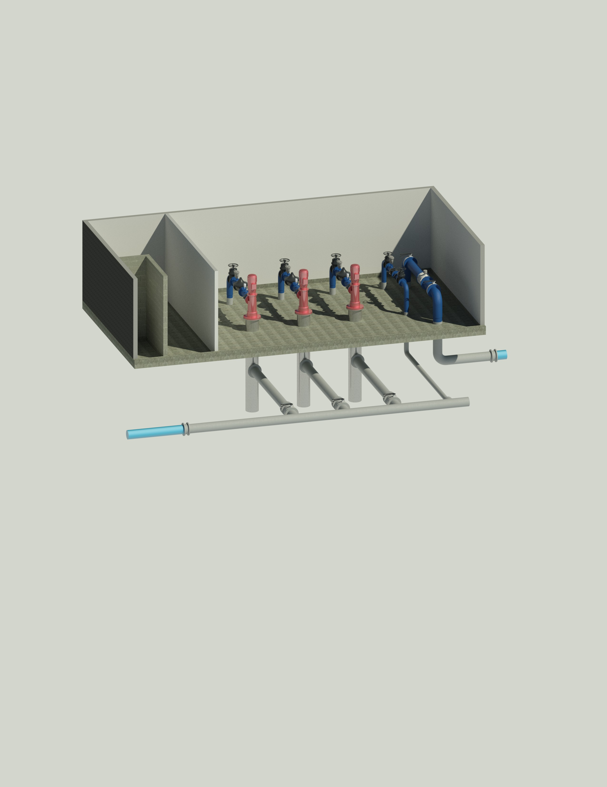
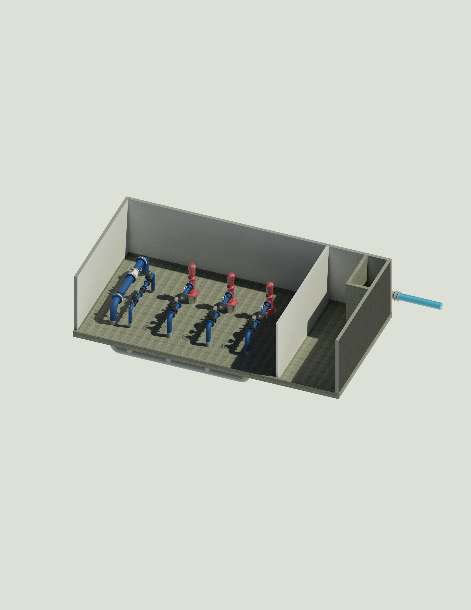

# Municipal Booster Pump Station — Revit BIM & Process Piping Package

A municipal Booster Pump Station modeled and documented in **Autodesk Revit 2027** based on Golden State Water Company (GSWC) standard utility drawings.

